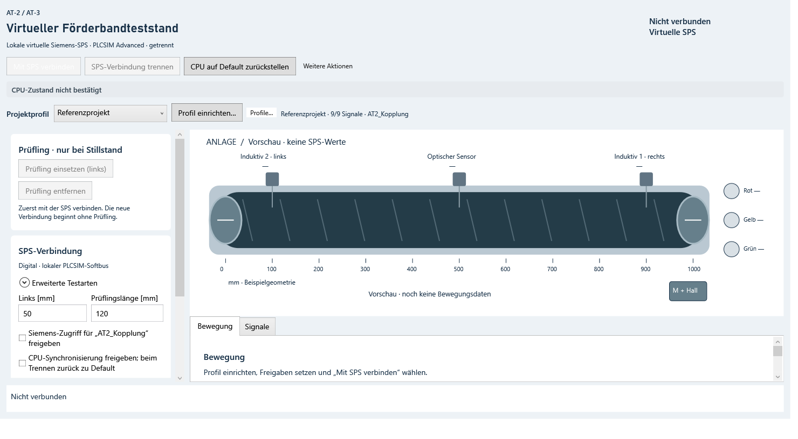

<a name="top"></a>

<div align="center">

[](#deutsch)
[](#english)

</div>

<a name="deutsch"></a>

# AT-2 / AT-3 Förderbandsimulator

C#-/WPF-Simulation der Förderbandanlage für die Praktikumsversuche AT-2 und AT-3.
Die Steuerung übernimmt das TIA-Programm auf einer lokalen virtuellen Siemens-SPS
in S7-PLCSIM Advanced. 

<div align="center">

[](#de-voraussetzungen)
[](#de-start)
[](#de-tia-projekte)
[](#de-bauen)
[](ANLEITUNG.md#deutsch)
[](ANLEITUNG.md#de-pruefungen)

</div>

### **Studentisches Lernprojekt, keine offizielle Hochschulvorlage oder Software!**
---



<a name="de-voraussetzungen"></a>

## Voraussetzungen

- Windows x64 und .NET Framework 4.8.
- TIA Portal V18 zum Bearbeiten und Laden der Übungsprogramme.
- S7-PLCSIM Advanced V5.0 Update 2 für die lokale virtuelle CPU im PLCSIM-Softbus-Modus.


<a name="de-start"></a>

## Starten

Das vollständige portable Paket an einen beschreibbaren Ort entpacken und
`AT2AT3.Simulator.exe` starten. Die Anwendung beginnt getrennt mit einer leeren
Anlagenvorschau. Sie erstellt und startet keine CPU.

1. TIA-Programm in die gewünschte virtuelle CPU laden. Vor dem Verbinden muss
   diese in RUN und im normalen PLCSIM-Modus Default sein.
2. **Projektprofil** wählen: Referenzprojekt, AT-2 Übung oder AT-3 Übung.
3. Unter **Profil einrichten** den CPU-Instanznamen und die Signaladressen prüfen.
   Mitgelieferte Profile werden als eigene Kopie gespeichert.
4. Die drei Verbindungsfreigaben setzen und **Mit SPS verbinden** wählen.
5. Bei stillstehendem Band **Prüfling einsetzen (links)**. Die SPS steuert den Ablauf.
6. Vor erneutem Laden aus TIA **SPS-Verbindung trennen** und die Default-Rückmeldung abwarten.

Messwerte und Zähler werden in der TIA-Beobachtungstabelle geprüft. Der Simulator zeigt zusätzlich
die Anlage und verschiedene E/A-Signale.

<a name="de-tia-projekte"></a>

## TIA-Projekte

| Profil | Datei | Ausgangszustand |
|---|---|---|
| AT-2 Übung | [Startarchiv](tia/AT2_Start_Uebung_Originalstand.zap18) | Vorgaben rekonstruiert; Programmieraufgaben und Signaladressen offen |
| AT-3 Übung | [Startarchiv](tia/AT3_Start_Uebung_Originalstand.zap18) | Motor-/Messgrundlogik vorbereitet; Ampel und HMI offen |
| Referenzprojekt | [Projektordner als ZIP](tia/AT2_AT3_Referenzprojekt.zip) | Eigener vorhandener noch unvollständiger Teststand |

Startarchive in TIA V18 dearchivieren. Das Referenz-ZIP vollständig entpacken und
`AT2_AT3_test/AT2_AT3.ap18` öffnen. Zum Üben jeweils eine Arbeitskopie verwenden.

Eigene Simulatorprofile liegen unter `profiles/` neben der EXE. Zum Umziehen den
vollständigen Anwendungsordner einschließlich dieser Profile kopieren. Die
Konfiguration benötigt keine persönlichen absoluten Pfade.

<a name="de-bauen"></a>

## Selbst bauen

Im Repositoryordner ausführen; das Setup ist nur nötig, wenn das passende .NET-SDK fehlt:

```powershell
.\tools\setup-sdk.ps1
.\build.ps1 -Test -UiSmoke -SiemensCompile
.\start.ps1
```

Der Siemens-Build benötigt das lokal installierte V5.0-SDK. Er startet keine
Siemens-Laufzeit. Ohne `-SiemensCompile` sind Build und automatisierte Tests auch
ohne Siemensinstallation möglich.

[Bedienung, Siemens-Anbindung und Prüfstand](ANLEITUNG.md) ·
[Lizenz](LICENSE) · [Drittanbieter](THIRD_PARTY_LICENSES.md)

Die digitale Kopplung wurde zuvor am eigenen Referenzstand erprobt.
Zusätzlich bestand eine separate AT-3-Prüfvariante vier Liveprüfungen mit
PLCSIM Advanced V5.0 Update 2 und dem C#-Anlagenkern. Profilwahl und geänderte
Signaladressen sind weiterhin nicht live verifiziert. WinCC und die sichtbare
WPF-Darstellung wurden bei diesen zusätzlichen Prüfungen nicht getestet.

<div align="center">

[](https://github.com/p-keminer/at2-at3-foerderbandsimulator)
[](https://gitlab.thga.de/philip.keminer/at2-at3-foerderbandsimulator)
[](#top)

</div>

---

<a name="english"></a>

# AT-2 / AT-3 Conveyor Belt Simulator

C#/WPF simulation of the conveyor belt used in the AT-2 and AT-3 lab exercises.
The TIA program running on a local virtual Siemens PLC in S7-PLCSIM Advanced
controls the system.

<div align="center">

[](#en-voraussetzungen)
[](#en-start)
[](#en-tia-projekte)
[](#en-bauen)
[](ANLEITUNG.md#english)
[](ANLEITUNG.md#en-pruefungen)

</div>

### **Student learning project, not an official university template or software!**
---


<a name="en-voraussetzungen"></a>

## Requirements

- Windows x64 and .NET Framework 4.8.
- TIA Portal V18 to edit and download the exercise programs.
- S7-PLCSIM Advanced V5.0 Update 2 for the local virtual CPU in PLCSIM Softbus mode.

<a name="en-start"></a>

## Getting started

Extract the complete portable package to a writable location and launch
`AT2AT3.Simulator.exe`. The application starts disconnected with an empty
plant preview. It does not create or start a CPU.

1. Download the TIA program to the intended virtual CPU. Before connecting,
   the CPU must be in RUN and in the normal PLCSIM Default mode.
2. Select a **Projektprofil** (project profile): Referenzprojekt, AT-2 Übung or AT-3 Übung.
3. Under **Profil einrichten** (configure profile), check the CPU instance name
   and signal addresses. Bundled profiles are saved as your own copy.
4. Enable the three connection confirmations and select **Mit SPS verbinden** (connect to PLC).
5. Once the belt is stationary, select **Prüfling einsetzen (links)** (insert workpiece on the left).
   The PLC controls the sequence.
6. Before downloading again from TIA, select **SPS-Verbindung trennen** (disconnect from PLC)
   and wait for confirmation that Default mode has been restored.

Check measured values and counters in the TIA watch table. The simulator also
displays the plant and its I/O signals.

<a name="en-tia-projekte"></a>

## TIA projects

| Profile | File | Starting state |
|---|---|---|
| AT-2 exercise | [Starter archive](tia/AT2_Start_Uebung_Originalstand.zap18) | Reconstructed starting requirements; programming tasks and signal addresses remain open |
| AT-3 exercise | [Starter archive](tia/AT3_Start_Uebung_Originalstand.zap18) | Basic motor and measurement logic prepared; signal lights and HMI remain open |
| Reference project | [Project folder as ZIP](tia/AT2_AT3_Referenzprojekt.zip) | Existing, still incomplete personal test project |

Retrieve the starter archives in TIA V18. Extract the reference ZIP completely
and open `AT2_AT3_test/AT2_AT3.ap18`. Use a working copy for each exercise.

Your simulator profiles are stored in `profiles/` next to the EXE. To move the
application, copy the entire application folder, including these profiles.
The configuration does not require personal absolute paths.

<a name="en-bauen"></a>

## Building from source

Run these commands from the repository directory. Setup is only necessary
if the required .NET SDK is missing:

```powershell
.\tools\setup-sdk.ps1
.\build.ps1 -Test -UiSmoke -SiemensCompile
.\start.ps1
```

The Siemens build requires the locally installed V5.0 SDK. It does not start
the Siemens runtime. Without `-SiemensCompile`, builds and automated tests
can also run without a Siemens installation.

[Operation, Siemens connection and verification](ANLEITUNG.md#english) ·
[License](LICENSE) · [Third-party licenses](THIRD_PARTY_LICENSES.md)

The digital connection was previously tried with the personal reference project.
A separate AT-3 test variant additionally passed four live checks with PLCSIM
Advanced V5.0 Update 2 and the C# plant core. Profile selection and changed
signal addresses remain unverified in live operation. WinCC and the visible
WPF rendering were not tested in these additional checks.

<div align="center">

[](https://github.com/p-keminer/at2-at3-foerderbandsimulator)
[](https://gitlab.thga.de/philip.keminer/at2-at3-foerderbandsimulator)
[](#top)

</div>
